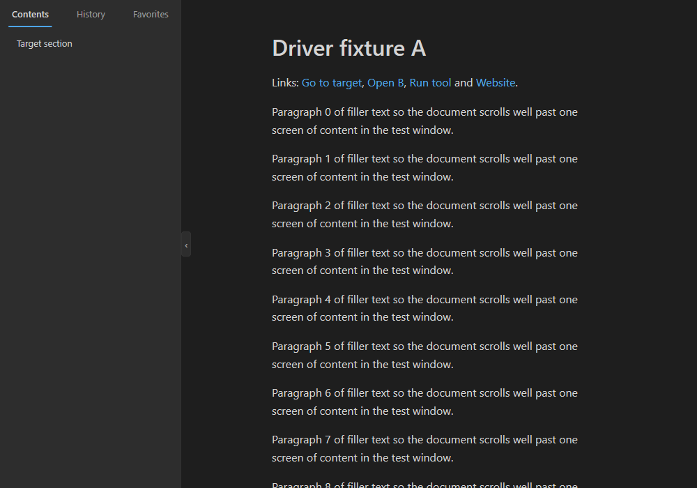
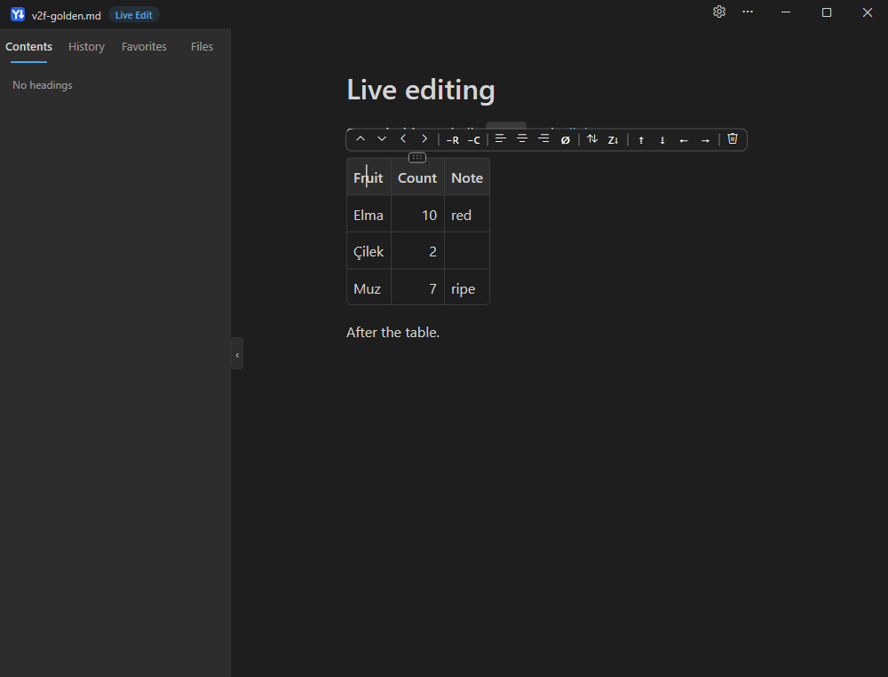
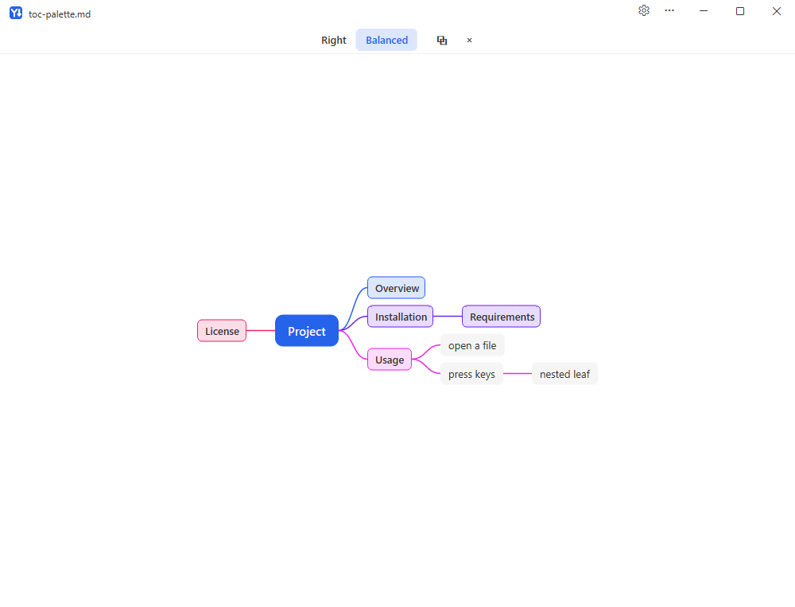

# YAMDV — Yet Another Markdown Viewer

**English** | [Türkçe](README.tr.md)

A native Windows Markdown viewer and editor written from scratch in Rust. Reading first, fully
offline, small (one `yamdv.exe`, a few MiB of working set), no runtime, no installer framework.

## Download

**[⬇ Download the latest version](https://github.com/snipeTR/YAMDV/releases/latest)** ·
[all releases](https://github.com/snipeTR/YAMDV/releases)

Get `YAMDV-<version>-win-x64.zip` from the release page. It is portable: unzip it anywhere and run
`yamdv.exe` (Windows 10/11 x64, no installer, no admin rights). The SHA-256 of the zip is in the
`.zip.sha256` file next to it and in the release notes. Turkish user guide:
[docs/KULLANIM_KILAVUZU.md](docs/KULLANIM_KILAVUZU.md) (also in the zip).


**Version 2.1.2.** Features:

- **Reading:** CommonMark + GFM (tables, task lists, footnotes, callouts, `<details>`), 30+ code
  lexers, native math (with macros) and Mermaid (flowchart, sequence, gantt, pie, state, class,
  ER, mindmap, `%%{init}%%`), local images incl. SVG, GIF and ICO; 11 colour schemes, light /
  dark / High Contrast, English and Turkish UI.
- **Navigation:** Files / Outline / Favorites / History sidebar, heading palette, mind map,
  fold toggles, tooltips, image / diagram / table viewers.
- **Editing:** WYSIWYG Live Edit (`F2`) and Split Edit (`F3`), table editing, find & replace,
  visual flowchart editing (click a node or edge: edit its label, `Delete`, `Tab` adds a node,
  drag a node onto another to connect; each change is written to the source and undoable).
- **Editor plugins:** "YAMDV: Open preview" for VS Code and Sublime Text in
  [`integrations/`](integrations/) (local launchers; build and install steps in their READMEs).
- **Toolbar and settings:** a toolbar with icons (*Settings ▸ Toolbar*: Off / Essentials / All
  presets, turn items on or off, reorder with ▲ / ▼), a searchable settings panel (⚙ or `Ctrl+,`)
  with a shortcut editor.
- **Export:** PDF with selectable text and bookmarks, interactive or static HTML, CSV, PNG.
- **Accessibility:** keyboard everywhere (`F6` cycles title bar, toolbar, sidebar, document),
  UI Automation for screen readers, High Contrast.

| Dark mode with the sidebar | Live Edit table | Mind map |
|---|---|---|
|  |  |  |

## Install, portable use, uninstall

- **Install for the current user (no admin):** run `yamdv.exe --install`, or start `yamdv.exe`
  and click **Install YAMDV for this user** on the welcome page. It copies itself to
  `%LOCALAPPDATA%\Programs\YAMDV\`, registers the Markdown file types, adds a Start-menu
  shortcut and an *Apps & features* entry, then starts the installed copy. Click
  **Set as default** on its welcome page; Windows Settings opens so you choose YAMDV yourself.
  Running `--install` again is safe (it refreshes the same files and keys).
- **Portable:** put an empty file named `yamdv.portable` next to `yamdv.exe`. Settings,
  history and favorites then live in `YAMDV-data\` beside the exe and nothing is registered.
- **Uninstall:** *Settings ▸ Apps ▸ YAMDV ▸ Uninstall*, or `yamdv.exe --uninstall`. A dialog
  asks whether to keep your settings; the registry values, the shortcut and the install folder
  are removed (exactly what `--install` wrote).

## Reading and editing

| Key | What it does |
|---|---|
| `F2` | **Live Edit**: edit the block under the caret in place; the rest stays rendered |
| `F3` | **Split Edit**: source on one side, live preview on the other |
| `F4`, `Ctrl+E` | open the file in your external editor (VS Code, Notepad++, Notepad, or a custom command) |
| right-click, `Shift+F10` | context menu: copy, appearance, file, export, settings |

Other shortcuts: `Ctrl+O` open · `F5` reload · `Ctrl+F` find (`Ctrl+G` / `Ctrl+Shift+G`) ·
`Ctrl+\` outline · `Ctrl+D` favorite · `Ctrl+C` / `Ctrl+Shift+C` copy / copy as Markdown ·
`Ctrl+=` / `Ctrl+-` / `Ctrl+0` font size · `Alt+↑` / `Alt+↓` column width · `Alt+←` / `Alt+→`
back / forward · `Ctrl+S` save (edit modes) · `Ctrl+P` print · `Ctrl+Shift+E` export PDF ·
`F1` all shortcuts · `F11` full screen · `Ctrl+Shift+O` heading palette · `Ctrl+Shift+M` mind map ·
`F6` / `Shift+F6` next / previous region (title bar, toolbar, sidebar, document) · `Esc`, `Ctrl+W` close.
All shortcuts can be changed in *Settings ▸ Shortcuts*.

## Export and print

- **Export ▸ Export HTML…** writes one self-contained `.html`: the current color scheme as
  inline CSS, a table of contents, highlighted code, and images, formulas and diagrams embedded
  as `data:` URIs. The interactive variant adds one hashed script (sidebar, folding, theme, find) under a strict
  Content-Security-Policy; `export.html_interactive = false` gives the script-free version.
- **Export ▸ Export PDF…** (`Ctrl+Shift+E`) writes a PDF with selectable, searchable text,
  bookmarks from the headings and working links; **Print…** (`Ctrl+P`) uses any printer. Pages break between blocks or lines; table rows,
  code lines and diagrams are never split.
- Right-click a table: **Copy table as CSV** / **Export table as CSV…** (UTF-8 with BOM, CRLF,
  RFC 4180; cells starting with `= + - @` or a tab are prefixed with `'` so spreadsheets do not
  run them as formulas).
- Headless: `yamdv --export-html in.md [-o out.html] [--theme github] [--mode light|dark]`,
  `yamdv --export-pdf in.md [-o out.pdf]`. Exit codes: 0 ok, 1 error, 2 usage.

## Privacy, and how to check it

YAMDV contains no networking code. It never downloads anything a document points to (remote
images show a placeholder), sends no telemetry and uploads no crash reports. Settings stay in
`%APPDATA%\YAMDV` (or `YAMDV-data` in portable mode). To check this yourself:

1. Block `yamdv.exe` in Windows Firewall (outbound). Nothing changes.
2. Open a document with remote images. While it is open, `netstat -ano` and Resource Monitor
   show no connection owned by `yamdv.exe`.
3. `cargo xtask check-imports yamdv.exe` lists the imported DLLs. No `ws2_32`, `winhttp`,
   `wininet`, `urlmon` or similar appear; CI runs this on every build.

Links open only when you click them, after a confirmation, in your default browser.

## Known limitations

Planned work is tracked as issues (https://github.com/snipeTR/YAMDV/issues). Examples: lazy layout of huge table rows
(PERF-08); WebP images show a placeholder; the first-paint and open-dialog times are being
verified on real hardware (PERF-02).

## Build from source

Requires Windows 10/11 x64 and the Rust toolchain pinned in `rust-toolchain.toml` (1.99.0,
MSVC target).

```
cargo build --release --locked -p yamdv-app      # target\release\yamdv.exe
cargo test --workspace --locked
cargo xtask ci                                   # fmt, clippy, tests, spec checks
```

Documentation: [`docs/SPEC.md`](docs/SPEC.md), [`docs/ARCHITECTURE.md`](docs/ARCHITECTURE.md),
[`docs/SECURITY.md`](docs/SECURITY.md), [`docs/PROCESS.md`](docs/PROCESS.md),
[`CHANGELOG.md`](CHANGELOG.md).

## License

License: AGPL-3.0-or-later (GNU Affero General Public License v3 or later, see [`LICENSE`](LICENSE)).
Source: https://github.com/snipeTR/YAMDV (Settings → About shows the exact tag of your build).
Third-party licenses: `THIRD_PARTY_NOTICES.txt` in the release zip (`cargo xtask notices`).
