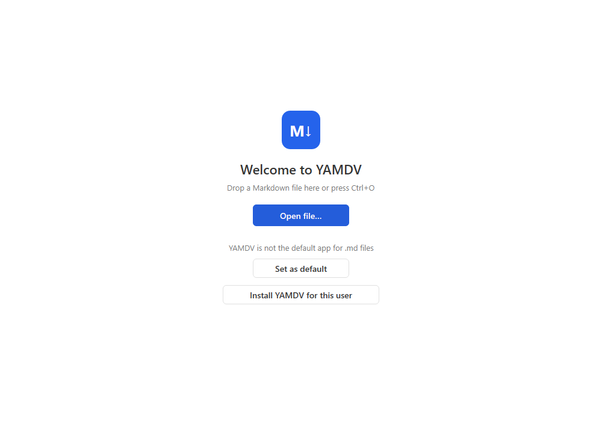
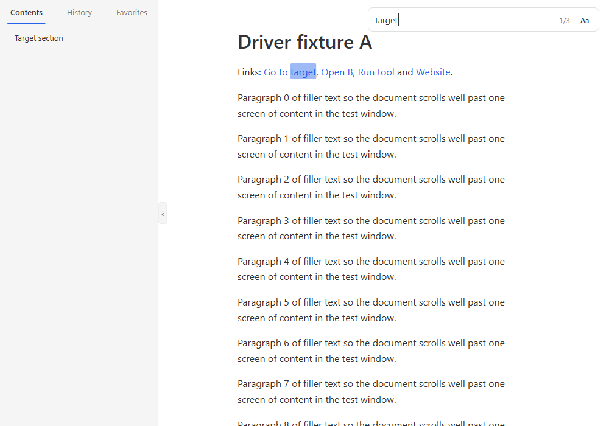
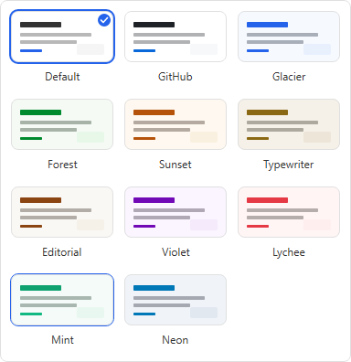
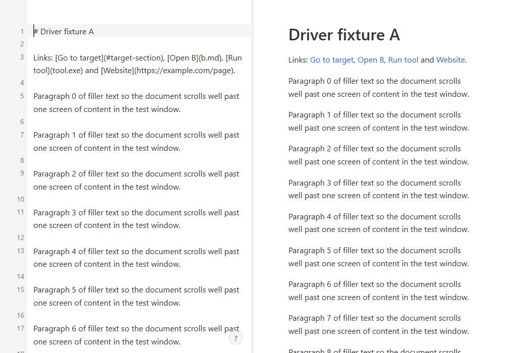
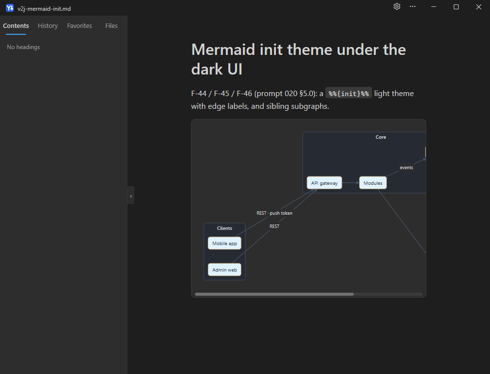

# YAMDV Kullanım Kılavuzu

YAMDV (Yet Another Markdown Viewer), Windows 10/11 için yazılmış, tamamen çevrimdışı çalışan,
küçük ve hızlı bir Markdown görüntüleyici ve düzenleyicidir. Bu kılavuz YAMDV **2.1.2** sürümünü
anlatır. Menü, düğme ve ayar adları Türkçe arayüzde göründükleri gibi yazılmıştır.

> Arayüz dili *Ayarlar ▸ Genel ▸ Dil* bölümünden seçilir (Sistem / English / Türkçe). "Sistem"
> seçiliyken Windows dili Türkçe ise arayüz Türkçe olur. Bu kılavuzdaki ekran görüntüleri test
> görüntülerinden alınmıştır ve bazıları İngilizce arayüzü gösterir.

## İçindekiler

1. [Kurulum ve indirme](#1-kurulum-ve-indirme)
2. [Dosya açma](#2-dosya-açma)
3. [Okuma](#3-okuma)
4. [Görünüm: tema, renk şeması, yazı boyutu](#4-görünüm-tema-renk-şeması-yazı-boyutu)
5. [Düzenleme: Canlı Düzenleme (F2) ve Bölünmüş Düzenleme (F3)](#5-düzenleme-canlı-düzenleme-f2-ve-bölünmüş-düzenleme-f3)
6. [Mermaid diyagramları ve matematik](#6-mermaid-diyagramları-ve-matematik)
7. [Araç çubuğu](#7-araç-çubuğu)
8. [Dışa aktarma, yazdırma, kopyalama](#8-dışa-aktarma-yazdırma-kopyalama)
9. [Zihin haritası, atlama listesi, düzenleyici eklentileri](#9-zihin-haritası-atlama-listesi-düzenleyici-eklentileri)
10. [Klavye kısayolları](#10-klavye-kısayolları)
11. [Ayarlar ve ayar dosyaları](#11-ayarlar-ve-ayar-dosyaları)
12. [Gizlilik: YAMDV ağa bağlanmaz](#12-gizlilik-yamdv-ağa-bağlanmaz)
13. [Sık sorulan sorular ve sorun giderme](#13-sık-sorulan-sorular-ve-sorun-giderme)

## 1. Kurulum ve indirme

**İndirme:** https://github.com/snipeTR/YAMDV/releases adresinden en son sürümün
`YAMDV-<sürüm>-win-x64.zip` dosyasını indirin. Yanındaki `.sha256` dosyası zip'in SHA-256
özetini içerir; PowerShell'de `Get-FileHash YAMDV-2.1.2-win-x64.zip` ile karşılaştırabilirsiniz.
Zip'in içinde `yamdv.exe`, `README.md`, `README.tr.md`, `LICENSE`, `CHANGELOG.md`, `FUTURE.md`,
`THIRD_PARTY_NOTICES.txt` ve bu kılavuz (`KULLANIM_KILAVUZU.md`) bulunur. Zip'teki kopyada ekran
görüntüleri yer almaz; görselli sürüm
https://github.com/snipeTR/YAMDV/blob/main/docs/KULLANIM_KILAVUZU.md adresindedir. Programın tamamı tek bir `yamdv.exe` dosyasıdır; ek çalışma zamanı
gerekmez.



### Geçerli kullanıcı için kurulum (yönetici izni gerekmez)

- `yamdv.exe`'yi çalıştırın ve karşılama sayfasında **YAMDV'yi bu kullanıcı için yükle**
  düğmesine tıklayın ya da komut satırında `yamdv.exe --install` çalıştırın.
- YAMDV kendini `%LOCALAPPDATA%\Programs\YAMDV\` klasörüne kopyalar, Markdown dosya türlerini
  (`.md`, `.markdown`, `.mdown`, `.mkd`, `.mkdn`, `.mdwn`, `.mdtxt`, `.mdtext`) kullanıcı için
  kaydeder, bir Başlat menüsü kısayolu ve *Uygulamalar ve özellikler* girdisi ekler, ardından
  kurulan kopyayı başlatır.
- **Varsayılan uygulama yapmak:** kurulan kopyanın karşılama sayfasında **Varsayılan yap**
  düğmesine (veya *Ayarlar ▸ Dosyalar ve Entegrasyon ▸ Varsayılan .md uygulaması*) tıklayın.
  Windows Ayarları açılır; YAMDV'yi orada kendiniz seçersiniz. YAMDV varsayılan uygulamayı asla
  kendi kendine değiştirmez.
- **Gezgin bağlam menüsü:** *Ayarlar ▸ Dosyalar ve Entegrasyon ▸ Gezgin bağlam menüsü* açıkken
  Markdown dosyalarına sağ tıklayınca "YAMDV ile aç" görünür (komut satırı:
  `yamdv --context-menu on|off`).
- `--install` komutunu yeniden çalıştırmak güvenlidir; aynı dosyaları ve kayıtları yeniler.
  Yeni bir sürüme geçmek için yeni `yamdv.exe` ile `--install` çalıştırmanız yeterlidir.

### Taşınabilir kullanım

`yamdv.exe`'nin yanına `yamdv.portable` adlı boş bir dosya koyun. Bu durumda ayarlar, geçmiş ve
sık kullanılanlar exe'nin yanındaki `YAMDV-data\` klasöründe tutulur ve kayıt defterine hiçbir
şey yazılmaz. USB bellekten çalıştırmak için uygundur. Taşınabilir modun açık olup olmadığı
*Ayarlar ▸ Dosyalar ve Entegrasyon ▸ Taşınabilir mod* satırında görünür.

### Kaldırma

*Windows Ayarları ▸ Uygulamalar ▸ YAMDV ▸ Kaldır* veya `yamdv.exe --uninstall`. Açılan pencere
ayarlarınızın, sık kullanılanlarınızın ve son dosyalarınızın saklanıp saklanmayacağını sorar:
**Kaldır, ayarları sakla** veya **Kaldır, ayarları sil**. Kayıt defteri değerleri, kısayol ve
kurulum klasörü kaldırılır (tam olarak `--install`'ın yazdıkları).

## 2. Dosya açma

- **Çift tık:** YAMDV varsayılan uygulamaysa Gezgin'de bir `.md` dosyasına çift tıklayın.
- **Dosya aç:** `Ctrl+O` veya karşılama sayfasındaki **Dosya aç…**. Süzgeçler: *Markdown*,
  *Metin* (`.txt`), *Tüm dosyalar*. Birden çok dosya seçebilirsiniz; her biri kendi penceresinde
  açılır.
- **Sürükle-bırak:** dosyaları pencereye bırakın; ilk dosya o pencerede, diğerleri yeni
  pencerelerde açılır. Bir **klasör** bırakırsanız kenar çubuğundaki *Dosyalar* sekmesi o
  klasörde açılır. Düzenleme kiplerinde bırakılan görsel veya dosya belgeye eklenir (bkz. 5.4).
- **Her dosya tek pencere:** zaten açık bir dosyayı yeniden açmak onun penceresini öne getirir.
  İkinci bir `yamdv.exe` başlatıldığında dosyayı çalışan örneğe iletir.
- **Son dosyalar:** karşılama sayfasındaki *Son dosyalar* listesi ve kenar çubuğundaki
  **Geçmiş** sekmesi (`Ctrl+Shift+2`). Geçmiş; *Bu oturum*, *Bugün*, *Dün* ve tarih gruplarına
  ayrılır. Bir öğenin üzerine gelince çıkan × onu listeden siler, grup başlığındaki *Temizle*
  grubu temizler.
- **Sık kullanılanlar:** `Ctrl+D` geçerli dosyayı ekler/çıkarır (sağ tık menüsünde
  "☆ Sık kullanılanlara ekle" / "★ Sık kullanılanlardan çıkar"). Liste kenar çubuğundaki
  **Sık kullanılanlar** sekmesindedir (`Ctrl+Shift+3`).
- **Dosyalar sekmesi** (`Ctrl+Shift+4`): belgenin klasöründeki Markdown dosyaları.
- **Canlı yeniden yükleme:** açık dosya başka bir programda değişip kaydedildiğinde YAMDV onu
  hemen yeniden gösterir; yalnızca değişen bloklar yeniden çizilir ve okuma yeriniz korunur.
  Düzenleme kiplerinde kaydedilmemiş değişikliğiniz yoksa değişiklik düzenleyiciye tek bir geri
  alma adımı olarak işlenir; varsa "Dosya diskte değişti" uyarısı **Üzerine yaz**,
  **Yeniden yükle (benimkileri at)** ve **Benimkini farklı kaydet…** seçeneklerini sunar.
- **Kodlama:** UTF-8 olmayan dosyalar otomatik algılanır; yanlış algılandıysa
  *sağ tık ▸ Dosya ▸ Kodlamayla yeniden aç* ile başka bir kodlama seçin.
- **Büyük dosyalar:** 20 MiB'tan büyük dosyalarda **Düz metin olarak aç (hızlı)** veya
  **Yine de işle** sorulur; 256 MiB üstü açılmaz.
- **Komut satırı:** `yamdv dosya.md`, `yamdv --line 120 dosya.md` (120. kaynak satırına gider).

## 3. Okuma


### Kenar çubuğu ve içindekiler

- `Ctrl+\` kenar çubuğunu açar/kapatır (*sağ tık ▸ Görünüm ▸ Ana hattı göster*). Sekmeler:
  **İçindekiler · Geçmiş · Sık kullanılanlar · Dosyalar** (`Ctrl+Shift+1…4`).
- *İçindekiler* başlık ağacını gösterir; bir başlığa tıklamak oraya kaydırır. Okuduğunuz bölüm
  vurgulanır. Alt başlıkları olan öğeler ▸/▾ ile katlanır.
- Konum: *sağ tık ▸ Görünüm ▸ Ana hat konumu* → **Sol**, **Sağ**, **Yüzen**. Genişliği kenarını
  sürükleyerek değiştirin. Derinlik ve yazı boyutu *Ayarlar ▸ Kenar çubuğu* bölümündedir.

### Bulma

- `Ctrl+F` bul çubuğunu açar. Yazdıkça tüm eşleşmeler vurgulanır ve "n/m" sayacı görünür.
  `Enter` / `Shift+Enter` sonraki / önceki; `Ctrl+G` / `Ctrl+Shift+G` her yerde çalışır.
- Seçenekler: **Aa** büyük/küçük harf duyarlı, **K** tam kelime, **.\*** düzenli ifade.
  Türkçe İ/ı harfleri doğru eşleşir. Katlanmış bölümlerdeki eşleşmeler açılır.



### Başlığa git ve gezinme

- `Ctrl+Shift+O` **Başlığa git…** paletini açar; yazarak başlıkları süzün, `Enter` ile gidin.
- `Alt+←` / `Alt+→` (veya farenin geri/ileri tuşları) bağlantılar arasında geri/ileri gider.
- Belge içi bağlantılar (`#başlık`) kaydırır; başka bir `.md` dosyasına giden bağlantılar o
  dosyayı açar (`Ctrl+tık` veya orta tık: yeni pencerede). Web bağlantıları varsayılan olarak
  onay sorulduktan sonra varsayılan tarayıcıda açılır (*Ayarlar ▸ Genel ▸ Dış bağlantılar*:
  Sor / Doğrudan / Asla).
- Başlık katlama: H1–H3 başlıklarının sol kenarına gelince ▸/▾ görünür; tıklamak bölümü katlar.
  `Alt+tık` o düzeydeki tüm başlıkları katlar/açar.
- Okuma konumu: bir dosyayı yeniden açtığınızda kaldığınız yerden devam edilir
  (*Ayarlar ▸ Genel ▸ Okuma konumunu geri yükle*).

### Yakınlaştırma ve sütun genişliği

- Yazı boyutu: `Ctrl+=` / `Ctrl+-` / `Ctrl+0` (sıfırla), `Ctrl+↑/↓` veya `Ctrl+tekerlek`
  (10–32 px). Metin gerçekten yeniden dizilir, bulanıklaşmaz.
- Sütun genişliği: `Alt+↑/↓`, `Alt+tekerlek`, `Alt+0` (pencerenin %30–100'ü).
- Tam ekran: `F11` (*sağ tık ▸ Görünüm ▸ Tam ekran*).

### Görsel, tablo ve diyagram görüntüleyicileri

Bir görselin, tablonun veya diyagramın üzerine gelince çıkan ⛶ simgesine tıklayın veya çift
tıklayın: tam ekran görüntüleyici açılır. Tekerlekle yakınlaştırın, sürükleyerek kaydırın,
`0` pencereye sığdırır, `Esc` kapatır. Tablolar burada sarılmadan tam genişlikte görünür.

### Sözcük sayısı (başlık çubuğunda)

*sağ tık ▸ Görünüm ▸ Sözcük sayısı* (veya araç çubuğundaki düğme) açıkken başlık çubuğunda dosya
adının hemen yanında "· 1234 sözcük · 7890 karakter" görünür. Metin seçiliyken "seçili / toplam"
gösterilir. Üzerine gelince satır sayısı, yaklaşık okuma süresi, kodlama ve satır sonları
görünür. Pencere darsa dosya adı öncelikli kalır ve sayı gizlenir.

## 4. Görünüm: tema, renk şeması, yazı boyutu

- **Tema modu:** *sağ tık ▸ Görünüm ▸ Tema modu* → **Sistem** (Windows'u izler), **Açık**,
  **Koyu**. Araç çubuğundaki tema düğmesi Sistem → Açık → Koyu arasında döner.
- **Renk şeması:** *sağ tık ▸ Görünüm ▸ Renk şeması…* 11 şemayı kart olarak gösterir (default,
  github, glacier, forest, sunset, typewriter, editorial, violet, lychee, mint, neon); kartın
  üzerine gelmek önizleme yapar.
- **Yazı tipi:** *Görünüm ▸ Metin yazı tipi…*; kod yazı tipi, satır yüksekliği ve paragraf
  aralığı *Ayarlar ▸ Yazı ve Yerleşim* bölümündedir.
- **Kod blokları:** *Görünüm ▸ Kod satır numaraları* ve *Kodu kaydır*.
- **Tek satır sonu = satır kesmesi:** tek Enter'ları satır kesmesi sayar.
- **Yüksek Karşıtlık:** Windows'un Yüksek Karşıtlık teması açıkken YAMDV sistem renklerini
  kullanır.
- **Özel renkler:** *Ayarlar ▸ Görünüm ▸ Özel renkleri kullan*; renkler `custom-theme.ini`
  dosyasında tutulur.

| Kart seçici | Koyu mod |
|---|---|
|  |  |

## 5. Düzenleme: Canlı Düzenleme (F2) ve Bölünmüş Düzenleme (F3)

### 5.1 Kipler

- **Canlı Düzenleme (`F2`):** belge işlenmiş görünümde kalır; imlecin bulunduğu blok yerinde
  düzenlenir. Biçim işaretleri (`**`, `#`, `>` …) yalnızca imleç o bölgedeyken görünür. Tablolar
  hücre hücre düzenlenir.
- **Bölünmüş Düzenleme (`F3`):** bir yanda kaynak metin (satır numaralı), öbür yanda canlı
  önizleme. Bölmeler *sağ tık ▸ Düzenle ▸ Bölmelerin yerini değiştir* ile yer değiştirir; oran
  ayırıcıyı sürükleyerek ayarlanır.
- Aynı tuş kipten çıkar; `Esc` de okuma kipine döner. `F4` / `Ctrl+E` dosyayı harici
  düzenleyicide açar (VS Code, Notepad++, Not Defteri veya *Ayarlar ▸ Harici düzenleyici*'de
  tanımlı program).
- Düzenleme kiplerinde araç çubuğunun arka planı hafif kırmızımsı olur; böylece düzenlemede
  olduğunuz hemen anlaşılır.



### 5.2 Kaydetme ve geri alma

- **Otomatik kaydetme** varsayılan olarak açıktır: son tuştan 800 ms sonra, kipten çıkarken ve
  pencere odağı kaybedince kaydedilir (*Ayarlar ▸ Düzenleme*). `Ctrl+S` hemen kaydeder.
  Kaydedilmemiş değişiklik varken başlıkta ● görünür.
- `Ctrl+Z` geri al, `Ctrl+Y` / `Ctrl+Shift+Z` yinele.
- Kurtarma: program beklenmedik biçimde kapanırsa bir sonraki açılışta "Önceki oturumdan
  kaydedilmemiş değişiklikler" şeridi **Geri yükle** / **Vazgeç** sunar.
- Salt okunur dosyalarda **Kopyasını farklı kaydet…** önerilir.

### 5.3 Düzenleme araç çubuğu ve biçimlendirme

- **Üst araç çubuğu:** düzenleme kiplerinde *Geri al, Yinele, Kalın, İtalik, Üstü çizili,
  Satır içi kod, Bağlantı, Başlık 1–3, Alıntı, Madde işaretli liste, Numaralı liste, Görev
  listesi* ile *Tablo ekle, Kod bloğu ekle, Matematik ekle, Diyagram ekle, Yatay çizgi ekle,
  Resim ekle, Dipnot ekle* düğmeleri araç çubuğuna eklenebilir (bkz. bölüm 7; bu öğeler yalnızca
  F2/F3'te görünür).
- **Yüzen biçim çubuğu (F2):** metin seçince seçimin üstünde çıkar: Kalın, İtalik, Üstü çizili,
  Vurgula, Satır içi kod, Bağlantı, H1, H2, H3, Alıntı, Madde listesi, Numaralı liste, Görev
  listesi, Biçimlendirmeyi temizle. `Esc` gizler.
- **Sağ tık menüsü:** Kes / Kopyala / Yapıştır / Düz metin olarak yapıştır, **Biçim ▸**,
  **Ekle ▸** (Tablo…, Kod bloğu, Bilgi kutusu ▸ Not/İpucu/Önemli/Uyarı/Dikkat, Matematik bloğu,
  Mermaid diyagramı, Yatay çizgi, Görsel…, Bağlantı…, Dipnot), tablo içindeyken **Tablo ▸**.
- **Yazarken dönüşüm (F2):** satır başında `# ` başlık, `- ` madde, `1. ` numaralı liste,
  `> ` alıntı, ```` ``` ```` + `Enter` kod bloğu, `---` + `Enter` yatay çizgi, `$$` + `Enter`
  matematik bloğu olur.
- **Tab kalıpları:** bir tetikleyici yazıp `Tab`'a basın: `h1`…`h6`, `table`, `table2x3`,
  `code`, dil adı (`python`, `rust`, `js` …), `link`, `img`, `hr`, `quote`, `task`,
  `note`/`tip`/`important`/`warning`/`caution`, `math`, `mermaid`, `flow`, `seq`, `gantt`,
  `date`, `time`, `details`, `footnote`. `Tab` sonraki yer tutucuya geçer.
- **Bul ve değiştir:** `Ctrl+H`; **Tümünü değiştir** tek bir geri alma adımıdır.
- **Satır işlemleri:** `Alt+↑/↓` satırı taşı, `Ctrl+Shift+D` çoğalt, `Ctrl+L` satırı seç.

### 5.4 Tablolar, görseller, yapıştırma

- **Tablolar:** `Ctrl+T` tablo ekler. `Tab` / `Shift+Tab` hücreler arasında, `Enter` alttaki
  hücreye geçer; `Shift+Enter` hücre içinde `<br>` ekler. `Ctrl+Alt+↑/↓` satırı,
  `Ctrl+Alt+←/→` sütunu taşır, `Ctrl+Shift+Backspace` satırı siler. *sağ tık ▸ Tablo ▸* satır /
  sütun ekleme-silme, hizalama ve sıralama içerir.

  

- **Görsel yapıştırma / dosya bırakma:** panodaki görsel veya bırakılan dosya belgenin yanındaki
  `assets/<belge-adı>/` klasörüne kopyalanır ve bağlantısı eklenir. Bunun için belgenin önce
  kaydedilmiş olması gerekir; 50 MB üstü dosyalar için onay sorulur.
- **Zengin yapıştırma:** web sayfasından kopyalanan HTML güvenli biçimde Markdown'a çevrilir;
  `Ctrl+Shift+V` düz metin yapıştırır.

## 6. Mermaid diyagramları ve matematik

### 6.1 Desteklenen Mermaid türleri

` ```mermaid ` kod blokları yerleşik olarak (JavaScript ve internet olmadan) çizilir:
**flowchart / graph, sequence, gantt, pie, state, class, ER, mindmap**; `%%{init}%%` tema
ayarları; sequence diyagramlarında `rect` renkli bantları. Desteklenmeyen bir tür veya söz dizimi
hatası kartta kaynakla birlikte hata satırı ve sütunu olarak gösterilir. Diyagrama sağ tıklayınca
**PNG olarak kopyala**, **Kaynağı kopyala**, **PNG olarak kaydet…** çıkar.



### 6.2 Görsel akış şeması düzenleme (F2 ve F3)

Canlı veya Bölünmüş Düzenlemede işlenmiş bir **flowchart / graph** diyagramı doğrudan
düzenlenebilir:

| İşlem | Nasıl |
|---|---|
| Düğüm veya kenar seçme | üzerine tıklayın (seçim mavi çerçeveyle gösterilir) |
| Etiketi düzenleme | çift tıklayın, `Enter`'a basın veya doğrudan yazmaya başlayın; `Enter` onaylar, `Esc` iptal eder |
| Silme | `Delete` veya `Backspace` (düğümle birlikte kenarları ve `class` / `style` / `click` satırları da silinir) |
| Yeni düğüm | `Tab`: seçili düğüme bağlı "New node" eklenir ve hemen adlandırılır |
| Bağlama | bir düğümü başka bir düğümün üzerine sürükleyin (`A --> B` eklenir) |
| Seçimi bırakma | `Esc` |

Her değişiklik Markdown kaynağına yazılır ve `Ctrl+Z` ile geri alınabilir; diyagramın geri
kalan satırları değişmez. Sınırlar: yalnızca flowchart/graph (diğer türler kaynaktan düzenlenir);
yerleşim otomatiktir (düğümler elle konumlandırılmaz); kartından geniş, çok karmaşık veya bir
alıntı/liste içindeki diyagramlar yalnızca kaynaktan düzenlenir; etiketler tek satırdır.

### 6.3 Matematik

`$…$` satır içi, `$$…$$` blok formüller Windows'taki Cambria Math yazı tipiyle yerleşik olarak
dizilir (KaTeX alt kümesi: kesirler, kökler, matrisler, ortamlar, aksanlar, yazı tipleri,
makrolar). Hatalı formül kırmızı gösterilir ve üzerine gelince hata açıklanır. F2'de imleç
formülün içindeyken kaynak ve canlı önizleme birlikte görünür. Matematik ve diyagram çizimi
*Ayarlar ▸ Okuma* bölümünden kapatılabilir.

## 7. Araç çubuğu

Başlık çubuğunun hemen altında simgeli bir araç çubuğu vardır. Varsayılan (**Önemliler**)
düğmeler: Dosya aç · Canlı düzenleme, Bölünmüş düzenleme | Bul, Başlığa git, Kenar çubuğu |
PDF olarak dışa aktar, Yazdır, Zihin haritası | Sık kullanılan, Tema | Ayarlar. Sığmayan
düğmeler sağdaki **»** menüsüne taşınır. Düğmenin üzerine gelince adı ve kısayolu görünür.
`F6` ile araç çubuğuna gelip `←/→` ile gezinip `Enter` ile çalıştırabilirsiniz.

*Ayarlar ▸ Araç çubuğu* bölümünde:

- **Hazır ayarlar:** **Kapalı** (araç çubuğunu gizler) / **Önemliler** (varsayılan 12 düğme) /
  **Hepsi** (tüm komutlar). Tek tek düğme açıp kapatırsanız **Özel** görünür.
- **Simge boyutu:** 16 / 20 / 24 piksel.
- **Liste:** tüm komutlar; her satırda açma/kapama anahtarı ve **▲ / ▼** (yukarı/aşağı taşı)
  düğmeleri. Sıralama `Alt+↑/↓` veya sürükle-bırak ile de değişir; araç çubuğu anında güncellenir.
  "Yalnızca Canlı / Bölünmüş Düzenleme" notlu öğeler yalnızca düzenleme kiplerinde görünür.
- **Araç çubuğunu sıfırla:** Önemliler setini, varsayılan sırayı geri getirir ve araç çubuğunu
  açar.

## 8. Dışa aktarma, yazdırma, kopyalama

Hepsi *sağ tık ▸ Dışa aktar* menüsünde ve araç çubuğundadır. Dışa aktarma arka planda çalışır,
ilerleme kartında ve görev çubuğu düğmesinde görünür ve iptal edilebilir.

- **HTML olarak dışa aktar…:** tek, kendi kendine yeten bir `.html` dosyası (renkler, içindekiler,
  vurgulanmış kod; görseller, formüller ve diyagramlar gömülü). *Etkileşimli HTML* açıkken
  kenar çubuğu, katlama, açık/koyu geçişi ve arama içerir; kapalıyken betik içermez
  (*Ayarlar ▸ Dışa aktarma ve Yazdırma*).
- **PDF olarak dışa aktar…** (`Ctrl+Shift+E`): seçilebilir ve aranabilir metin, başlıklardan yer
  imleri, çalışan bağlantılar. Sayfa boyutu, kenar boşlukları, sayfa numaraları ve renkler
  ayarlanabilir. Kısa bloklar ve tablo satırları sayfa arasında bölünmemeye çalışılır.
- **Yazdır…** (`Ctrl+P`): herhangi bir yazıcı.
- **Zengin HTML olarak kopyala:** belgenin tamamını biçimli olarak panoya kopyalar (Word,
  Outlook vb. içine yapıştırmak için). **Markdown olarak kopyala** (`Ctrl+Shift+C`) seçimin
  Markdown kaynağını kopyalar.
- **Tablolar:** *sağ tık ▸ Tabloyu CSV olarak kopyala* / *Tabloyu CSV olarak dışa aktar…*
  (BOM'lu UTF-8; `= + - @` ile başlayan hücrelere `'` eklenir).
- **Komut satırı:** `yamdv --export-html girdi.md -o çıktı.html`,
  `yamdv --export-pdf girdi.md -o çıktı.pdf` (`--theme github`, `--mode light|dark`). Pencere
  açılmaz; hata olursa çıkış kodu sıfırdan farklıdır.

## 9. Zihin haritası, atlama listesi, düzenleyici eklentileri

### Zihin haritası

`Ctrl+Shift+M` veya *Dışa aktar ▸ Zihin haritası olarak görüntüle*: başlıklar dallara, liste
öğeleri yapraklara dönüşür. Tekerlekle yakınlaştırın, sürükleyerek kaydırın, bir düğüme
tıklayarak katlayın/açın, çift tıklayarak o başlığa gidin. Yerleşim **Sağ** veya **Dengeli**
olabilir; harita PNG olarak kopyalanabilir. `Esc` kapatır.


### Atlama listesi

Görev çubuğundaki YAMDV simgesine sağ tıklayınca Geçmiş'teki son 10 dosya görünür. Geçmiş
kapatılır veya temizlenirse liste de boşalır.

### VS Code ve Sublime Text eklentileri

Depodaki `integrations/` klasöründe iki küçük başlatıcı eklenti vardır. Her ikisi de
**YAMDV: Open preview** komutuyla düzenlediğiniz dosyayı `yamdv.exe [--line N] -- <dosya>`
olarak açar; YAMDV dosyayı izlediği için her kaydetmede önizleme kendiliğinden yenilenir. Ağ
erişimi ve telemetri yoktur; hiçbir mağazada yayımlanmamıştır.

- **VS Code** (`integrations/vscode/`): Komut Paleti'nde, Markdown dosyalarının başlık
  çubuğunda ve Gezgin sağ tık menüsünde. Ayarlar: `yamdv.path`, `yamdv.passLine`,
  `yamdv.saveFirst`. Kurulum: Node.js 18+ ile `npm install`, `npm run package`, ardından
  `code --install-extension yamdv-preview-<sürüm>.vsix`.
- **Sublime Text** (`integrations/sublime/`): klasörü *Preferences ▸ Browse Packages…* altına
  `YAMDV` adıyla kopyalayın. Kısayol `Ctrl+Alt+M`; Komut Paleti ve sağ tık menüsünde de vardır.
  Ayarlar: `path`, `pass_line`, `save_first`.
- `yamdv.exe` şu sırayla aranır: ayardaki yol → `PATH` → `%LOCALAPPDATA%\Programs\YAMDV\yamdv.exe`
  (`--install` ile kurulan kopya).

## 10. Klavye kısayolları

`F1` geçerli tüm kısayolları gösterir. Hepsi *Ayarlar ▸ Kısayollar* bölümünden değiştirilebilir
(çakışmalar gösterilir); **Hazır ayar** olarak "Typora" düzeni de seçilebilir.

### Genel

| Tuş | İşlem |
|---|---|
| `Ctrl+O` | Dosya aç |
| `Ctrl+W`, `Esc` | Pencereyi kapat (`Esc` yalnızca okuma kipinde, açık panel yokken) |
| `F5` | Yeniden yükle |
| `Ctrl+\` | Kenar çubuğunu göster/gizle |
| `Ctrl+Shift+1` / `2` / `3` / `4` | İçindekiler / Geçmiş / Sık kullanılanlar / Dosyalar |
| `Ctrl+D` | Sık kullanılana ekle/kaldır |
| `Ctrl+F`, `Ctrl+G`, `Ctrl+Shift+G` | Bul, sonrakini bul, öncekini bul |
| `Ctrl+Shift+O` | Başlığa git |
| `Ctrl+Shift+M` | Zihin haritası |
| `Ctrl+=` / `Ctrl+-` / `Ctrl+0` | Metni büyüt / küçült / sıfırla (ayrıca `Ctrl+↑/↓`, `Ctrl+tekerlek`) |
| `Alt+↑` / `Alt+↓` / `Alt+0` | Sütunu genişlet / daralt / sıfırla (okuma kipinde) |
| `Alt+←` / `Alt+→` | Geri / İleri |
| `F2` / `F3` | Canlı düzenleme / Bölünmüş düzenleme |
| `F4`, `Ctrl+E` | Harici düzenleyicide aç |
| `Ctrl+Shift+E` | PDF olarak dışa aktar |
| `Ctrl+P` | Yazdır |
| `Ctrl+C` / `Ctrl+Shift+C` / `Ctrl+A` | Kopyala / Markdown olarak kopyala / Tümünü seç |
| `Ctrl+,` | Ayarlar |
| `F1` | Klavye kısayolları |
| `F11` | Tam ekran |
| `F6` / `Shift+F6` | Sonraki / önceki bölge (başlık çubuğu, araç çubuğu, kenar çubuğu, belge) |

### Düzenleme kipleri (F2 / F3)

| Tuş | İşlem |
|---|---|
| `Ctrl+S` | Kaydet |
| `Ctrl+Z` / `Ctrl+Y`, `Ctrl+Shift+Z` | Geri al / Yinele |
| `Ctrl+X` / `Ctrl+V` / `Ctrl+Shift+V` | Kes / Yapıştır / Düz metin olarak yapıştır |
| `Ctrl+B` / `Ctrl+I` / `Ctrl+Shift+X` | Kalın / İtalik / Üstü çizili |
| `Ctrl+Shift+H` / ``Ctrl+` `` | Vurgula / Satır içi kod |
| `Ctrl+K` / `Ctrl+Shift+I` | Bağlantı / Görsel ekle |
| `Ctrl+1` … `Ctrl+6` / `Ctrl+Shift+0` | Başlık 1–6 / Paragraf |
| `Ctrl+Shift+Q` | Alıntı |
| `Ctrl+Shift+8` / `7` / `9` | Madde işaretli / Numaralı / Görev listesi |
| `Ctrl+Enter` | Görevi işaretle |
| `Ctrl+Shift+K` / `Ctrl+T` | Kod bloğu / Tablo ekle |
| `Ctrl+H` | Bul ve değiştir |
| `Alt+↑` / `Alt+↓` | Satırı yukarı / aşağı taşı |
| `Ctrl+Shift+D` / `Ctrl+L` | Satırı çoğalt / Satırı seç |
| `Tab` / `Shift+Tab` | Girinti / girintiyi azalt (kalıp tetikleyicisinden sonra: kalıbı genişlet) |
| `Esc` | Düzenlemeden çık |

### Okuma kipinde gezinme ve fare

`↑/↓` 40 px kaydırır; `PgUp/PgDn`, `Space/Shift+Space` bir ekran; `Home/End` başa/sona;
`Tab` bağlantılar ve düğmeler arasında dolaşır, `Enter` çalıştırır. Fare: `Ctrl+tekerlek`
yazı boyutu, `Alt+tekerlek` sütun genişliği, `Shift+tekerlek` kod/tabloda yatay kaydırma,
çift tık kelime, üçlü tık paragraf seçer; sağ tık bağlam menüsünü açar.

## 11. Ayarlar ve ayar dosyaları

**Ayarlar** paneli: başlık çubuğundaki ⚙, *sağ tık ▸ Ayarlar…* veya `Ctrl+,`. Değişiklikler
anında uygulanır ve kaydedilir (Tamam/Uygula yoktur); üstteki kutuda ayar arayabilirsiniz.
Bölümler: **Genel, Görünüm, Yazı ve Yerleşim, Kenar çubuğu, Araç çubuğu, Okuma, Düzenleme,
Kısayollar, Harici düzenleyici, Dışa aktarma ve Yazdırma, Dosyalar ve Entegrasyon, Gizlilik ve
Güvenlik, Hakkında**. *Hakkında* bölümü sürümü, lisansı ve tam bu sürümün kaynak kod adresini
(`https://github.com/snipeTR/YAMDV/tree/v<sürüm>`) gösterir.

**Dosyaların yeri** (*Ayarlar ▸ Dosyalar ve Entegrasyon ▸ Yapılandırma klasörünü aç*):

| Dosya / klasör | Normal | Taşınabilir mod |
|---|---|---|
| `settings.ini` (ayarlar, kısayollar) | `%APPDATA%\YAMDV\` | `YAMDV-data\` |
| `state.ini` (pencere, geçmiş, sık kullanılanlar, okuma konumları) | `%APPDATA%\YAMDV\` | `YAMDV-data\` |
| `custom-theme.ini` (özel renkler) | `%APPDATA%\YAMDV\` | `YAMDV-data\` |
| `logs\`, `recovery\` | `%LOCALAPPDATA%\YAMDV\` | `YAMDV-data\` |

**Sıfırlama:**

- Paneldeki **Bölümü sıfırla** yalnızca o bölümü, **Tümünü sıfırla…** her ayarı varsayılana
  döndürür (kısayollar ve özel renkler korunur). Kısayollar için *Kısayollar ▸ Hazır ayara
  sıfırla*, renkler için *Görünüm ▸ Tüm renkleri sıfırla*, araç çubuğu için *Araç çubuğunu
  sıfırla* kullanılır.
- Geçmiş, sık kullanılanlar ve okuma konumları *Gizlilik ve Güvenlik* bölümünden temizlenir.
- Tamamen sıfırlamak için YAMDV'yi kapatıp yapılandırma klasöründeki `settings.ini` (ve
  istenirse `state.ini`, `custom-theme.ini`) dosyasını silin.

## 12. Gizlilik: YAMDV ağa bağlanmaz

YAMDV'de hiçbir ağ kodu yoktur. Belgenin işaret ettiği hiçbir şeyi indirmez (uzak görseller yer
tutucu olarak gösterilir), telemetri göndermez, çökme raporu yüklemez, güncelleme denetlemez.
Bağlantılar yalnızca siz tıkladığınızda, onaydan sonra, varsayılan tarayıcınızda açılır.
İnternetten indirilmiş dosyalarda "Bu dosya internetten geldi" şeridi görünür ve bağlantılar her
zaman sorulur. *Tanılama günlüğü* varsayılan olarak kapalıdır; açılırsa yalnızca yerel bir
dosyaya (`%LOCALAPPDATA%\YAMDV\logs\yamdv.log`) belge metni olmadan yazar.

**Kendiniz doğrulayın:**

1. Windows Güvenlik Duvarı'nda `yamdv.exe` için giden bağlantıları engelleyin: hiçbir şey
   değişmez.
2. Uzak görseller içeren bir belge açın. Açıkken `netstat -ano` veya Kaynak İzleyicisi
   (*Ağ* sekmesi) `yamdv.exe`'ye ait hiçbir bağlantı göstermez.
3. Kaynaktan derlediyseniz `cargo xtask check-imports yamdv.exe` içe aktarılan DLL'leri listeler:
   `ws2_32`, `winhttp`, `wininet`, `urlmon` gibi ağ kitaplıkları yoktur. CI bunu her derlemede
   denetler.

## 13. Sık sorulan sorular ve sorun giderme

**Windows SmartScreen "Windows bilgisayarınızı korudu" diyor.**
`yamdv.exe` kod imzalı değildir. Dosyayı resmi sürüm sayfasından indirdiyseniz ve SHA-256 özeti
`.sha256` dosyasıyla eşleşiyorsa *Ek bilgi ▸ Yine de çalıştır* seçebilirsiniz.

**.md dosyalarım hâlâ başka programla açılıyor.**
Önce `--install` ile kurun, sonra **Varsayılan yap** düğmesiyle açılan Windows Ayarları'nda
YAMDV'yi seçin. YAMDV bu seçimi güvenlik nedeniyle kendisi yapamaz.

**Görseller görünmüyor.**
Uzak (`http/https`) görseller bilerek indirilmez. Yerel görsellerde yolun belgeye göre doğru
olduğundan emin olun; bulunamayan görsel yer tutucuyla gösterilir.

**Bir diyagram "henüz desteklenmiyor" veya söz dizimi hatası gösteriyor.**
Desteklenen türler bölüm 6.1'dedir. Hata kartı satır ve sütunu gösterir; diyagramı F3'te
düzeltip sonucu canlı izleyebilirsiniz.

**Görsel akış şeması düzenleme çalışmıyor.**
Yalnızca F2/F3'te ve yalnızca flowchart/graph diyagramlarında çalışır. F2'de imleç diyagramın
kaynağındaysa önce diyagramın dışına tıklayın. Çok geniş veya alıntı/liste içindeki diyagramlar
yalnızca kaynaktan düzenlenir.

**Dosya düzenlenemiyor.**
Salt okunur dosyalarda **Kopyasını farklı kaydet…**; çözülemeyen baytlar içeren dosyalarda
**UTF-8'e dönüştür ve düzenle** önerilir. Düz metin olarak açılmış çok büyük dosyalar ve yerleşik
yardım belgeleri düzenlenemez.

**Türkçe karakterler bozuk görünüyor.**
*sağ tık ▸ Dosya ▸ Kodlamayla yeniden aç* ile doğru kodlamayı (ör. Windows-1254) seçin.

**Yazılar çok küçük / satırlar çok uzun.**
`Ctrl+=` ile büyütün, `Alt+↓` ile sütunu daraltın; ayarlar kalıcıdır.

**Araç çubuğu kayboldu.**
*Ayarlar ▸ Araç çubuğu* bölümünde **Önemliler**'i seçin veya **Araç çubuğunu sıfırla**'ya
tıklayın. `F11` tam ekranda araç çubuğu gizlenir.

**Ayarlarım bozuldu, baştan başlamak istiyorum.**
Bölüm 11'deki sıfırlama adımlarını izleyin.

**Hata bildirmek veya kaynak koda bakmak istiyorum.**
Kaynak kod ve sürümler: https://github.com/snipeTR/YAMDV. Lisans: AGPL-3.0-or-later.
