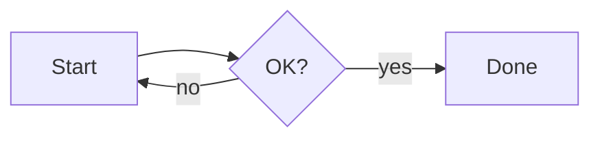
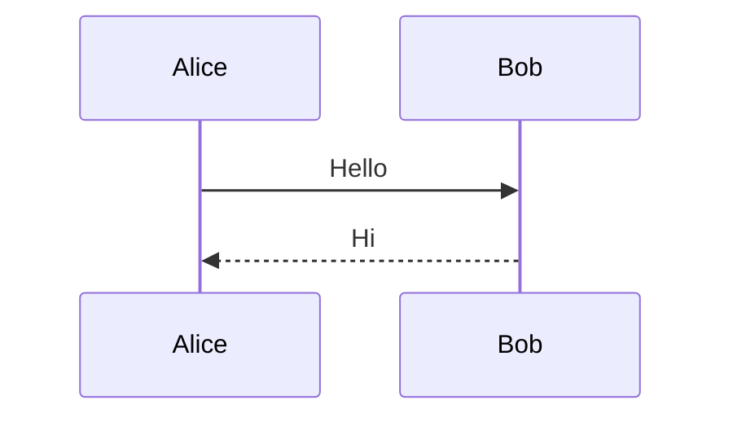

# 012_V2B_SETTINGS_PANEL — YAMDV Phase V2-B: Export fixes, owner test pack, settings panel → v1.1.0

> **Prompt 012, revised 2026-10-22.** This version **replaces** the earlier prompt 012. If work from the earlier version already exists on the branch, keep it and continue.
> - Branch `phase/v2b-settings`, tag `phase-v2b`
> - Version **1.1.0** is prepared but **not tagged**: the tag waits for the owner's OK (A-8)
> - Report `docs/reports/v2b_REPORT.md` (≤ 80 lines)
> - Store this file as received in `docs/prompts/`, replacing the earlier 012
>
> **Precedence:** `docs/PROCESS.md` (A-1…A-8) > this prompt > `docs/UI_SPEC.md` / `docs/SPEC.md` > the rest of `docs/*`.
> **Order:** §2 → §3 → §4 → §5. **Resumable:** if the quota runs low, follow §7. The owner gives this same prompt again to continue.

---

## 1. Review of V2-A — accepted; owner feedback
- **V2-A is accepted** and needs no fixes.
- **Two bugs from the owner.** The owner tested Export on a real PC and found BUG-10 and BUG-11 (§3). They are fixed **first**.
- **No CI.** GitHub Actions is not available. From this phase on, the owner runs every Windows test from a test pack (A-8).

## 2. Setup (by script; keep it cheap)
1. **A-8.** Add A-8 to `docs/PROCESS.md` through the amendment mechanism:
```text
A-8 No CI; the owner runs the Windows tests (owner decision, 2026-10-22). Applies from Phase V2-B until the owner turns CI back on; where it differs from A-7, A-8 wins.
1. Every commit message ends with [skip ci], which also skips pull_request runs. Do not change workflows or repository settings.
2. Local gates before every push: fmt; clippy native + cargo-xwin x86_64-pc-windows-msvc, with and without dev-tools; tests of the platform-independent crates; deny; spec-check; check-imports; size.
3. Put as much new logic as possible into platform-independent crates with unit tests, so it is verified without Windows.
4. Windows-only checks (driver scripts, golden compare, M0/M1/T4/T7) are written as usual; the owner runs them from the test pack, and the report marks them "OWNER (A-8)". No new goldens: planned goldens become screenshots in the pack's screens\ folder for the owner to look at.
5. Test pack, once per phase:
   - YAMDV-<phase>-test.zip plus its SHA-256, built locally with cargo-xwin;
   - uploaded as the draft pre-release test-<phase> (gh release create test-<phase> --draft --prerelease; to replace assets, gh release upload --clobber);
   - contents: yamdv.exe (release), yamdv-dev.exe (dev-tools), baseline\yamdv-dev.exe (the dev-tools build of main before this phase, for same-PC comparisons), the driver scripts, the existing goldens, the fixtures, run-tests.cmd and OWNER_TEST.md (numbered manual checks in EN and TR).
6. run-tests.cmd:
   - one double-click, no admin rights;
   - runs every driver script, the golden compare and M0/M1/T4/T7 the way CI did, and M0/M1 also for the baseline;
   - writes test-results.txt (one line per test: PASS / FAIL / SKIP + numbers + delta vs the baseline) and puts the diff PNGs of failures in failures\;
   - golden diffs on the owner's PC are reported with their pixel percentage and are not a gate (DPI, fonts and ClearType differ from the CI runner);
   - uses a temporary config folder and never touches the owner's settings, history, favorites, registry, or any files outside its own folder and %TEMP%;
   - scripts that touch the registry or install anything are skipped unless --include-system is given;
   - prints the expected duration and asks the owner not to use the mouse or keyboard while it runs.
7. Gates on the owner's run: M0 and M1 at most +0.3 MiB vs the baseline on the same PC; T7 = 0; T4 is reported.
8. Merge: after the local gates pass, merge to main and tag phase-<x>. Version tags (v1.x.0) and their releases wait for the owner's OK; the next prompt then tags them and uploads the zip with gh (no Actions). Owner-reported failures go first in the next prompt.
9. Report ≤ 80 lines: a local-gates table, the pending owner tests, and the test-pack link.
```
2. **Embedded files.** Extract `docs/ROADMAP_V2.md` (it replaces the current file) and `tests/fixtures/colors.md`, both at the end of this prompt. Use the extraction command from prompt 009 step 3, pointed at this prompt file. Do not re-type them.
3. **Spec patches** (`docs/spec-patches/v2b.txt`, applied with `xtask spec-patch`):

**P-34** — `docs/SPEC.md`, R-EXP-01. OLD:
```text
colors per setting `pdf_colors` (*Follow theme* default, or *Light*), backgrounds kept (dark themes do not turn white unless *Light* is chosen);
```
NEW:
```text
colors per setting `pdf_colors` (*Light* default = the scheme's light palette on a white page, whatever the UI mode; or *Follow theme* = the current mode, with the theme background on the whole page);
```

**P-35** — `docs/SPEC.md`, R-EXP-02. OLD:
```text
one `.html` with inline CSS for the current theme,
```
NEW:
```text
one `.html` with inline CSS from the current scheme in the palette chosen by `html_colors` (*Light* default, or *Follow theme*),
```

**P-36** — `docs/SPEC.md`. INSERT AFTER the anchor line:
```text
- **R-EXP-06 SHOULD** Copy whole document as rich HTML; export a Mermaid diagram or the mind map as PNG.
```
NEW line:
```text
- **R-EXP-07 MUST** Export PDF, Print and Export HTML never block the UI. The job runs outside the UI thread (PDF and Print in the print worker process, ADR-0018) on a snapshot of the document as shown, including unsaved edits. It reports progress on the export progress card (B.10.7) and on the taskbar button; [Cancel] stops it and removes the partial file; one job runs at a time. Exports never contain selection, find highlights, hover or focus states, and math and Mermaid images in them are rendered in the export palette.
```

**P-37** — `docs/UI_SPEC.md`, B.8.2. OLD:
```text
| `export.pdf_colors` | enum | `theme` | `theme`, `light` |
```
NEW:
```text
| `export.pdf_colors` | enum | `light` | `light`, `theme` |
```

**P-38** — `docs/UI_SPEC.md`, B.8.2. INSERT AFTER the anchor line:
```text
| `export.print_colors` | enum | `light` | `light`, `theme` |
```
NEW line:
```text
| `export.html_colors` | enum | `light` | `light`, `theme` |
```

**P-39** — `docs/UI_SPEC.md`, B.10.6. INSERT AFTER the anchor line:
```text
Popover (external link "Ask", link editor, language picker, color picker): width 360, radius 8, `menu_bg`, `shadow`, anchored to its target; URL shown in code font 12 px, wrapped. In-window confirm dialog: width 420, title 15 px 600, body 13 px, buttons right-aligned (primary last), `Enter` = primary, `Esc` = cancel, backdrop `rgba(0,0,0,.25)`. Native dialogs are used only for open/save files and printing. Tooltips: 500 ms delay, 12 px, padding 4 × 8, radius 4.
```
NEW lines:
```text
### B.10.7 Export progress card
Bottom-center, above the toast stack; width 360, radius 8, `menu_bg`, `shadow`; shown only when a job runs longer than 300 ms. Line 1: 13 px 600 "Exporting PDF…" / "Printing…" / "Exporting HTML…" plus the file name (middle ellipsis). Bar: 4 px, `accent` on a `border` track; indeterminate while preparing (static with reduced motion), determinate after. Line 2: 12 px `text_muted` "Page 37 of 1093 · 3 % · about 3 min left" (HTML counts blocks; the estimate appears after 5 pages or 5 %). [Cancel] right-aligned; `Esc` cancels while the card has focus. Success replaces it with a toast "PDF saved — <name>" with [Open] · [Show in folder]; failure replaces it with an error banner (B.10.5). The taskbar button mirrors the progress (`ITaskbarList3`).
```

4. **Issues.** Create the two owner issues if they do not exist yet. Check first with `gh issue list --state all --search "BUG-10 in:title"`, and the same for BUG-11:
```bash
gh issue create --label bug --milestone post-v1 --title "BUG-10: Exports use the dark palette (PDF, Print, HTML)" --body "Owner report on v1.0.0: in dark mode, Export PDF printed text on black backgrounds. Fix per prompt 012 §3.1 (P-34, P-35, P-37, P-38)."
gh issue create --label bug --milestone post-v1 --title "BUG-11: UI freezes during Export PDF / Print / HTML; no progress" --body "Owner report on v1.0.0: the window stops responding while a PDF is created. Fix per prompt 012 §3.2 (R-EXP-07, B.10.7)."
```
5. **TRACEABILITY.** Add R-EXP-07, by script.

---

## 3. Part 1 — Owner bugs (do these first)

### 3.1 BUG-10: exports use the dark palette
**Symptom:** with the app in dark mode, Export PDF printed the text on black backgrounds. Export HTML is expected to have the same problem.

**Palette per job:**
- Each job takes its palette only from its own setting:
  - Export PDF and `--export-pdf`: `pdf_colors`
  - Print…: `print_colors`
  - Export HTML and `--export-html`: `html_colors`
- `light` (the default for all three) means the scheme's light tokens on a white page, whatever the UI mode.
- `theme` means the current mode, coherent across the whole page. A dark box on a white page, or light text on a light background, is always a bug.
- The UI mode must not reach a job any other way. On `--export-html`, the existing `--mode` option sets the palette.

**Every surface uses the export palette:**
- page, paragraph and block backgrounds
- code and inline code, including syntax token colors
- table header and zebra rows
- quotes and callouts
- footnotes, `<details>` and the TOC
- math and Mermaid images, which are rendered again in the export palette and never taken from the screen cache

**Never exported:** selection, find highlights, hover and focus states.

**Settings panel:** the three settings appear in the panel's Export & Print section (§4).

**Unit tests** (platform-independent):
- palette resolution for each setting × each UI mode;
- Export HTML of `tests/fixtures/colors.md` with a dark UI and `html_colors=light`:
  - the generated CSS contains no dark-palette token value;
  - the `body` background is `#ffffff`.

### 3.2 BUG-11: the window freezes during export; no progress
**Cause:** the UI thread waits on the print worker process (ADR-0018). On `large-1mb.md` the job takes about 205 s for 1093 pages.

**Never block the UI thread:**
- The message loop keeps running.
- The end of the worker is detected through its process handle, with `RegisterWaitForSingleObject` or `MsgWaitForMultipleObjectsEx` in the loop.
- ADR-0018's process isolation stays.
- The worker receives the exact text that is shown, including unsaved edits. If it re-reads the file from disk today, change that.
- Later edits do not affect a running job.

**Progress messages:**
- The worker sends progress records over the existing `WM_COPYDATA` channel, with the nonce + PID check, at most every 100 ms.
- Each record carries the phase (`preparing` | `printing`), the current page n and the total N.
- The record codec and the time estimate are pure code, covered by unit tests.

**Progress card:** as in B.10.7 (P-39), built on demand and freed when it hides. Taskbar progress uses `ITaskbarList3`:
- create it lazily, after the `TaskbarButtonCreated` message;
- show the error state on failure;
- clear it at the end.

**While a job runs:**
- **Usable app:** reading, scrolling, switching documents and editing all keep working.
- **One job at a time:** Export PDF, Print and Export HTML are disabled.
- **Closing:** closing the window asks "An export is running" with [Cancel export and close] and [Keep exporting].

**Cancel:**
- The main window signals an inheritable cancel event.
- The worker checks it between pages and between bands, calls `AbortDoc`, deletes the partial file and exits.
- A toast says "Export cancelled".

**End:**
- **Success:** the toast offers [Open] and [Show in folder]. Both work on local paths only: [Open] uses `ShellExecuteExW` on the output file; [Show in folder] uses explorer `/select,`.
- **Failure or worker crash** (exit code ≠ 0): an error banner shows the reason, and the partial file is deleted.

**Export HTML:**
- Uses the same worker, card, Cancel and taskbar progress; progress counts blocks.
- Writes to a temp file in the target folder and renames it at the end (atomic, as saving does). Cancel or failure deletes the temp file.
- CSV export stays as it is.

**Memory and idle CPU:**
- Nothing new loads at startup.
- After a job, PWS returns to within +0.2 MiB of its value before the job.
- T7 stays 0, because every timer stops.

**Speed:** about 190 ms per page is not a goal here. The speed fix is the native PDF writer (FUT-39, V2-H). Keep reporting T10.

---

## 4. Part 2 — V2-B settings
Specifications: `docs/UI_SPEC.md` §B.8 (the panel and the normative settings table), §B.10.6 and §B.16; `docs/SPEC.md` R-SET-01…06, R-THEME-04, R-THEME-06/07 and S-PRIV-04. Issues: FUT-31, FUT-04, FUT-49, FUT-05, and the *settings search* half of FUT-26.

1. **Settings panel** (B.8.1; FUT-31)
   - **Opening and frame:**
     - It opens with ⚙, with `Ctrl+,` and with a single **Settings…** menu item. That item replaces the *Settings ▸* submenu; the *Appearance ▸* quick toggles stay.
     - It is an in-window modal panel per B.8.1: 720 × 560, clamped to window − 48.
     - The 48 px header drags the panel.
   - **Layout:**
     - The navigation (180 px) is on the left and the sections scroll on the right.
     - Sections: General · Appearance · Typography & Layout · Sidebar · Reading · Editing · Shortcuts · External editor · Export & Print · Files & Integration · Privacy & Security · About.
   - **Rows:** each row has a label, an optional `text_muted` description, and the control on the right.
     - Show **only settings whose feature exists today**, with values, ranges and defaults from B.8.2.
     - Later phases add the rows for their own features.
     - Export & Print includes `pdf_colors`, `print_colors` and `html_colors`.
   - **Apply and reset:**
     - Every change applies **instantly** and is written atomically to `settings.ini` (R-SET-03).
     - Each section has *Reset section*. *Reset all* is in General, behind a confirm dialog (R-SET-04).
   - **Keyboard:** `Tab` moves focus with the visible focus ring (B.16), the arrow keys work inside controls, and `Esc` closes the panel.
   - **Controls** (custom-drawn, token-driven, EN/TR):
     - toggle, segmented control, dropdown (reuse the V2-A popup), slider with a live value, button, color swatch, shortcut-capture field;
     - a **single-line text input** built on the editor core: caret, selection, clipboard, IME and undo.
   - **Section extras:**
     - **Files & Integration:**
       - default-app status with [Set as default]
       - the Explorer context-menu toggle
       - the config folder path with [Open folder]
       - [Edit custom-theme.ini]
       - the portable-mode indicator
       - [Install for this user], when not installed
     - **Privacy & Security:**
       - the offline statement and how to verify it
       - the diagnostic-log toggle
       - [Clear history], [Clear favorites] and [Forget reading positions] (S-PRIV-04), each behind a confirm
     - **About:**
       - version and build commit
       - "License: to be decided"
       - the exe path and the config path; clicking one copies it and shows a toast
   - **Memory:** the panel is built on demand and **fully freed on close**.
2. **Settings search** (first half of FUT-26)
   - A search box above the navigation filters rows by label and description, in the current UI language.
   - `Ctrl+F` focuses it while the panel is open.
   - The filter is pure code, covered by unit tests.
3. **Font pickers** (R-THEME-04; FUT-49)
   - **Lists:** the body font and the code font are searchable dropdowns of the installed families.
     - The families are enumerated **only when a list opens** (the DirectWrite system collection), never at startup (D.6).
     - The code-font list puts monospace families first (`IDWriteFont1::IsMonospacedFont`).
   - **Rows:** each name is drawn in its own face, and only the visible rows are drawn (virtualized). The resolved font name is shown under the control.
   - **Dialog host:** this replaces the `ChooseFontW` dialog-host path. Remove the `font` kind unless something else still uses it.
4. **Custom-color editor** (R-THEME-06/07; FUT-04)
   - **Tokens:** Appearance lists the 11 tokens: `bg`, `text`, `heading`, `link`, `accent`, `quote_bar`, `code_bg`, `border`, `table_header_bg`, `zebra_bg`, `selection`. Each token has a light swatch and a dark swatch.
   - **Picker:** a swatch opens a color-picker popover with a saturation/value square, a hue slider, a hex input and *Reset token*.
   - **Saving:** changes apply live and are written to `custom-theme.ini` under `[light]` / `[dark]`; the `border` alias follows P-03.
   - **Reset and toggle:** *Reset all colors* removes the file's entries after a confirm. `appearance.use_custom_colors` turns the whole layer on and off.
   - **Unit tests:** hex/HSV conversion and the ini round trip.
5. **Shortcuts** (F.1–F.6, E.7; FUT-05)
   - **List:** every action, with its localized name, its current chord and a capture field. The capture field shows *"Press a key combination…"*; `Esc` cancels and `Backspace` clears.
   - **Conflicts:** a conflict shows inline in `error`, naming the other action. Nothing is saved until the conflict is resolved.
   - **Presets:** a preset dropdown offers **Default** and **Typora** (the F.6 diffs), with *Reset to preset*.
   - **Saving:** overrides are written to the `[shortcuts]` section of `settings.ini`. The menus' shortcut column updates live.
   - **Unit tests:** conflict detection and the Typora diff.
6. **Prepare v1.1.0**
   - Set version 1.1.0 in the workspace, the version resource and About.
   - Add a `CHANGELOG.md` entry covering V2-A, V2-B, BUG-10 and BUG-11.
   - **Do not tag** (A-8 rule 8).

**Out of scope:**
- tooltips, popovers and banners beyond the color-picker popover and the error banner (those come in V2-C);
- every later roadmap item.

---

## 5. Part 3 — First owner test pack (A-8 rules 5–6)
1. **`run-tests.cmd`:** port the commands of the CI Windows test job into it, keeping the same scripts and thresholds. Give the dev-tools build a temp config-folder override if it does not have one. Force 96 DPI and the CI rendering parameters for driver runs, as far as the dev-tools build allows.
2. **New driver scripts (4):**
   - `settings-panel`:
     - ⚙ opens the panel;
     - keyboard navigation reaches Reading;
     - toggling *Code line numbers* updates the document and `settings.ini`;
     - *Reset section*;
     - `Esc` closes the panel;
     - PWS ends within +0.1 MiB of its value before opening.
   - `color-editor`:
     - set the link color to `#ff0000` with the hex input;
     - the color is applied and `custom-theme.ini` is written;
     - *Reset token*.
   - `shortcuts`:
     - rebinding *Find* to `Ctrl+Alt+F` works;
     - capturing `Ctrl+O` shows a conflict;
     - the Typora preset sets *Split Edit* to `Ctrl+/`.
   - `export-progress` (the extra script for the owner bugs; skip it with a note when there is no "Microsoft Print to PDF"):
     - Run 1, on a fixture of about 30 pages:
       - `SendMessageTimeout(WM_NULL, 100 ms)` always succeeds during the job, and scrolling works;
       - the pages rise monotonically to N;
       - the file exists at the end.
     - Run 2, on `large-1mb.md`:
       - Cancel after 5 pages;
       - then: no file, no worker process, PWS within +0.2 MiB and T7 = 0.
     - Run 3, `colors.md` in dark UI mode: probe pixels on print page 1 (the corner, inside a paragraph, around the code block) for light-palette values.
3. **Screenshots** in `screens\` (instead of goldens):
   - the panel's General section (light) and Appearance section (dark)
   - the color-picker popover
   - the Shortcuts section
   - the progress card
4. **`OWNER_TEST.md`** (EN + TR, numbered):
   1. Run `run-tests.cmd` and send `test-results.txt`.
   2. Export `colors.md` to PDF and to HTML, in light mode and in dark mode (4 files): each has a white page, no dark areas and no selection or find highlight. Then set the colors to *Follow theme*: the dark export is dark everywhere.
   3. Export PDF on a large file:
      - the app stays usable;
      - the card shows the page, the percentage and the time left;
      - the taskbar shows progress;
      - Cancel removes the file;
      - at the end, [Open] and [Show in folder] work.
   4. Print… shows the same card. Closing the window during a job asks first.
   5. Export HTML on a large file: the card appears, and the file appears only at the end.
   6. Open the settings panel in 3 ways. Use `Tab`, the arrow keys and `Esc`. Search for "font".
   7. Change the theme, the body font and the code font (monospace families listed first): each change applies instantly.
   8. Edit the link color, then use *Reset token*, *Reset all colors* and the custom-colors toggle.
   9. Rebind *Find*, see the `Ctrl+O` conflict, and apply the Typora preset.
   10. Use *Clear history* (with its confirm), and click to copy a path in About.
   11. Switch to the Turkish UI: the panel is in Turkish.
   12. The open V2-A checks: Snap Layouts, the dark title bar, the ⋯ menu with Alt/F10, the scheme cards, F11.
5. **Upload:** build `YAMDV-v2b-test.zip` and its SHA-256, and upload them as the draft pre-release `test-v2b`.

---

## 6. Merge and report
- **Merge:** once the local gates pass, open the PR with "Closes #n" for BUG-10, BUG-11, FUT-31, FUT-04, FUT-49 and FUT-05. Comment on FUT-26 that the settings search is done; leave it open. Merge, then tag `phase-v2b`.
- **Report** (≤ 80 lines):
  - the local-gates table;
  - the unit-test counts;
  - the exe-size delta;
  - the list of "OWNER (A-8)" tests;
  - the `test-v2b` link with its SHA-256;
  - deviations;
  - "Next action".

## 7. Stop rule (quota)
If the Grok quota runs low at any point:
1. commit and push the current state with `[skip ci]`;
2. write `docs/reports/v2b_REPORT.md` with a done / partial / not-started table for §2–§6 and **"Next action: …"**;
3. stop.

The owner will give this same prompt again.

---

## 8. Acceptance criteria
| ID | Criterion |
|---|---|
| AC-1 | §2 is done: A-8, the roadmap, `colors.md`, P-34…P-39 with `spec-check` green, the BUG-10/BUG-11 issues, and R-EXP-07 in TRACEABILITY. |
| AC-2 | BUG-10 and BUG-11 are fixed as in §3, and their unit tests pass. |
| AC-3 | §4 items 1–5 work per B.8 and the spec IDs listed; every existing setting is reachable in the panel; nothing the panel needs loads at startup; the unit tests pass; version 1.1.0 is prepared but not tagged. |
| AC-4 | The local gates are green; the PR is merged with the issues closed or commented as listed; `phase-v2b` is tagged; the test pack (4 new driver scripts, screens, `run-tests.cmd`, `OWNER_TEST.md`) is uploaded as `test-v2b` with its SHA-256. |
| AC-5 | The report has ≤ 80 lines and the content listed in §6. |

**END OF PROMPT 012.** Start with §2 now.

---

## Embedded files (extracted in §2 step 2 — do not re-type them)

<!-- FILE: docs/ROADMAP_V2.md -->
````markdown
# YAMDV — Roadmap v2 (owner plan, 2026-10-22; revised the same day)

**Goal:** turn v1.0.0 into the product originally specified in `docs/SPEC.md` and `docs/UI_SPEC.md` (before the v1 scope cut), phase by phase, while staying as fast and light as v1. **The order is UI first**, then reading/editing features, then content engines and export, then hardening and performance.

Each phase implements the listed items. Their requirement IDs come back into scope, `docs/TRACEABILITY.md` moves them from `deferred (FUT-xx)` to DONE, and the merged PR closes the matching GitHub issues (milestone `post-v1`).

**Rules:**
- Bugs the owner reports from real-PC use go first in the next prompt.
- Since V2-B there is no CI. The owner runs the Windows tests from a test pack (PROCESS A-8).
- Version tags wait for the owner's OK.

| Phase | Prompt | Content | Items (issue IDs) | Release |
|---|---|---|---|---|
| V2-A | 011 | Window chrome: custom title bar with ⚙ and ⋯ buttons, layered popup menus (B.7), color-scheme cards, F11 fullscreen, word-count badge, zoom indicator | FUT-30, FUT-32, FUT-35, FUT-46, BUG-09 | — |
| V2-B | 012 | **First:** A-8 owner test pack; owner bugs — the export palette (PDF, Print, HTML; `colors.md` fixture) and non-blocking export with a progress card + Cancel. **Then:** settings panel (B.8, all sections), custom-color editor, font pickers, shortcut list + key capture + Typora preset, settings search | BUG-10, BUG-11, FUT-31, FUT-04, FUT-49, FUT-05, FUT-26 | v1.1.0 |
| V2-C | 013 | Tooltips, anchored popovers, banners; fullscreen viewers (image, table, diagram) with ⛶ badges; heading folding; inline objects for sup/sub/footnote refs; wide diagrams scroll instead of shrinking | FUT-40, FUT-36, FUT-06, FUT-34, FUT-41, BUG-08 | — |
| V2-D | 014 | Navigation: Files tab, floating sidebar, favorites reorder, heading jump palette + `[TOC]`, mind-map view; keyboard reachability of every control | FUT-33, FUT-02, FUT-03, FUT-08, FUT-37, HARD-04 | v1.2.0 |
| V2-E | 015 | Editing plus: F2 format toolbar, find & replace (+ regex, mirrored in F3), snippets, image/file paste, recovery journal, editor extras, HTML paste → Markdown | FUT-45, FUT-12, FUT-15 | — |
| V2-F | 016 | Tables and full WYSIWYG: table toolbar and operations, drag handles, TSV paste, F2 inline marker reveal, F2 table cell editing | FUT-44, FUT-43 | v1.3.0 |
| V2-G | 017 | Content engines: math beyond the core + macros; Mermaid gantt, pie, state, class, ER + `%%{init}%%` + Copy as PNG; SVG images; animated GIF; ICO/WebP; more highlight languages | FUT-17, FUT-18, FUT-20, FUT-48, FUT-01 | — |
| V2-H | 018 | Export and integration: native PDF writer (vector text, bookmarks, links; also the PDF speed fix), interactive HTML export (hash CSP), copy rich HTML / PNG, more external editors, reopen with encoding, jump list, custom icons; known bugs | FUT-39, FUT-21, FUT-23, FUT-10, FUT-09, FUT-25, BUG-01…07 | v1.4.0 |
| V2-I | 019 | Hardening: full security review + THREAT_MODEL, long fuzzing, ACG re-verification, High Contrast + UI Automation, real-hardware QA | HARD-01…03, FUT-47, QA-01 | — |
| V2-J | 020 | Performance and 2.0: final memory budgets (Appendix D final column), dialog latency, scroll paths, Mermaid rasters, binary size, incremental live reload, stable-hardware perf gates, DIB/DDB | PERF-01…07, FUT-42 | v2.0.0 |
| Later | — | Not planned for v2: editor plugins (FUT-27), macOS/Linux (FUT-28), more UI languages (FUT-29), code signing / winget / ARM64 / spell check (IDEA-01…04), license (DEC-01, owner decision) | — | — |

The reviewer may re-cut the order from the phase reports. A phase that does not finish continues in the next prompt (A-3 rule 9).
````

<!-- FILE: tests/fixtures/colors.md -->
````markdown
# Color check / Renk kontrolü

**How to test / Nasıl test edilir:**

1. **Before exporting:** select this sentence and search for "zebra" with Ctrl+F, so that a selection and find highlights are on screen.
   Dışa aktarmadan önce bu cümleyi seç ve Ctrl+F ile "zebra" ara.
2. **Export:** export to **PDF** and to **HTML**, in **light** mode and again in **dark** mode, so you get 4 files.
   PDF ve HTML'e, açık ve koyu modda aktar (4 dosya).
3. **Expected with the default setting (Light):** in all 4 files you see a white page, dark text and light block colors. There is no black or dark area anywhere, and no selection or find highlight.
   Varsayılan ayarla (Açık) 4 dosyada da beyaz sayfa, koyu yazı ve açık renkli bloklar olmalı. Hiçbir yerde siyah/koyu alan, seçim ya da arama vurgusu olmamalı.
4. **Expected with "Follow theme":** the dark-mode export is dark **everywhere**. A dark box on a white page is a bug.
   "Temayı takip et" ayarıyla koyu moddaki çıktı her yerde koyu olmalı. Beyaz sayfada koyu kutu hatadır.

## Headings / Başlıklar
### Heading 3
#### Heading 4
##### Heading 5
###### Heading 6

## Text / Metin
Plain text, **bold**, *italic*, ***bold italic***, ~~strikethrough~~, ==highlight==, `inline code`, an [external link](https://example.com) and a [relative link](./README.md).

## Code / Kod
```rust
// comment / yorum
fn main() {
    let name = "YAMDV"; // string
    let n: u32 = 42;    // number
    if n > 0 {
        println!("{name} {n}");
    }
}
```

## Quote / Alıntı
> A quote with a bar on the left.
> > A nested quote.

## Callouts
> [!NOTE]
> Note.

> [!TIP]
> Tip.

> [!IMPORTANT]
> Important.

> [!WARNING]
> Warning.

> [!CAUTION]
> Caution.

## Table / Tablo
| Token | Where / Nerede | Expected / Beklenen |
|---|---|---|
| table_header_bg | header row | light gray |
| zebra_bg | rows 2 and 4 | very light |
| border | cell lines | thin, visible |
| text | every cell | dark |

## Lists / Listeler
- [x] Done task
- [ ] Open task

1. First
2. Second

## Footnote / Dipnot
A sentence with a footnote.[^1]

[^1]: The footnote, with a back-link.

## Details
<details><summary>Click to open / Açmak için tıkla</summary>Hidden text / Gizli metin.</details>

---

## Math / Matematik
Inline: $e^{i\pi} + 1 = 0$. Block:

$$
\int_0^1 x^2\,dx = \frac{1}{3}
$$

## Mermaid



````
