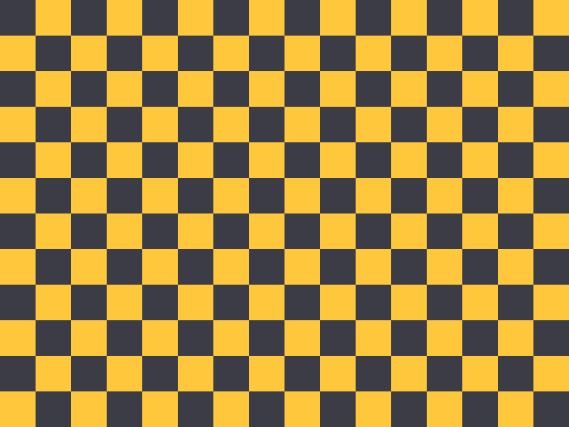

# Images

Inline badges:   and a local  in a line.

A remote block image:

Local relative: 

Parent folder: 

Data URI: 

Missing: 

UNC path (blocked before any file access): 

WebDAV (blocked): 

SVG (unsupported until Phase 010): 

Obsidian size: ![[one.png|300]]

