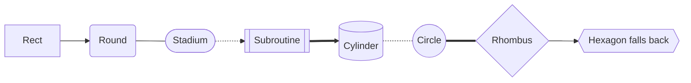
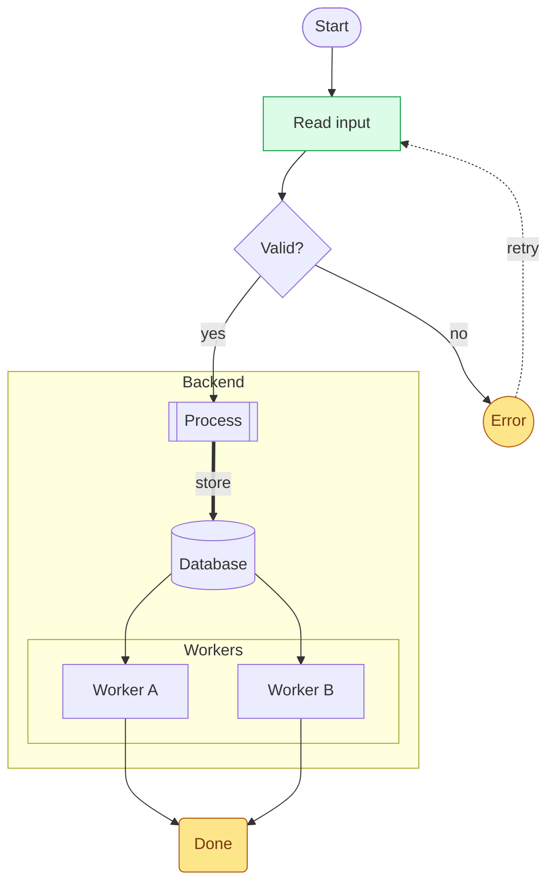
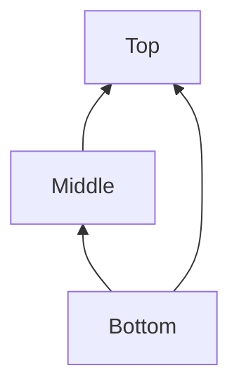
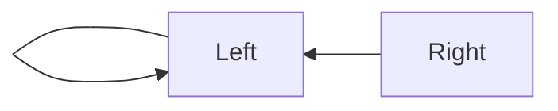
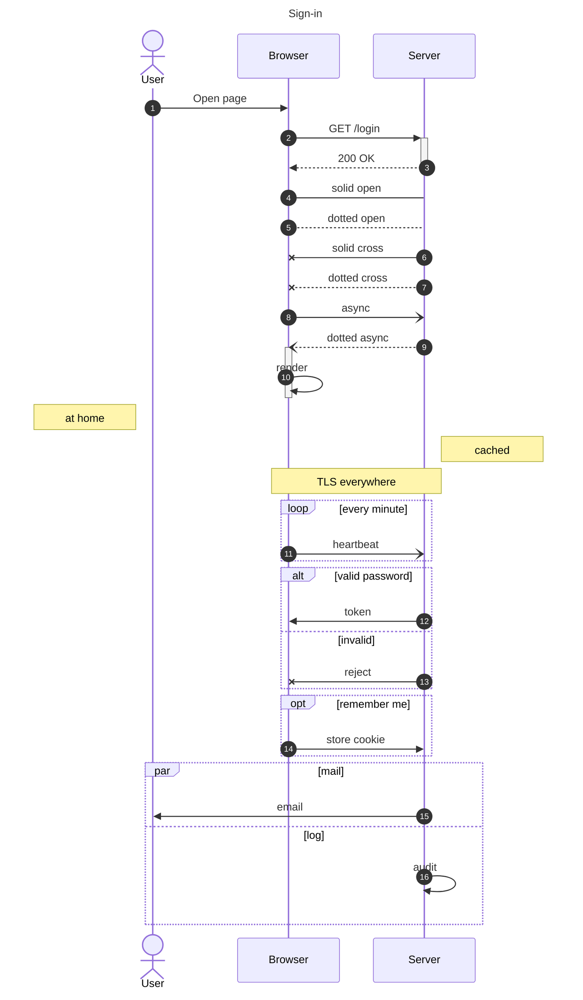
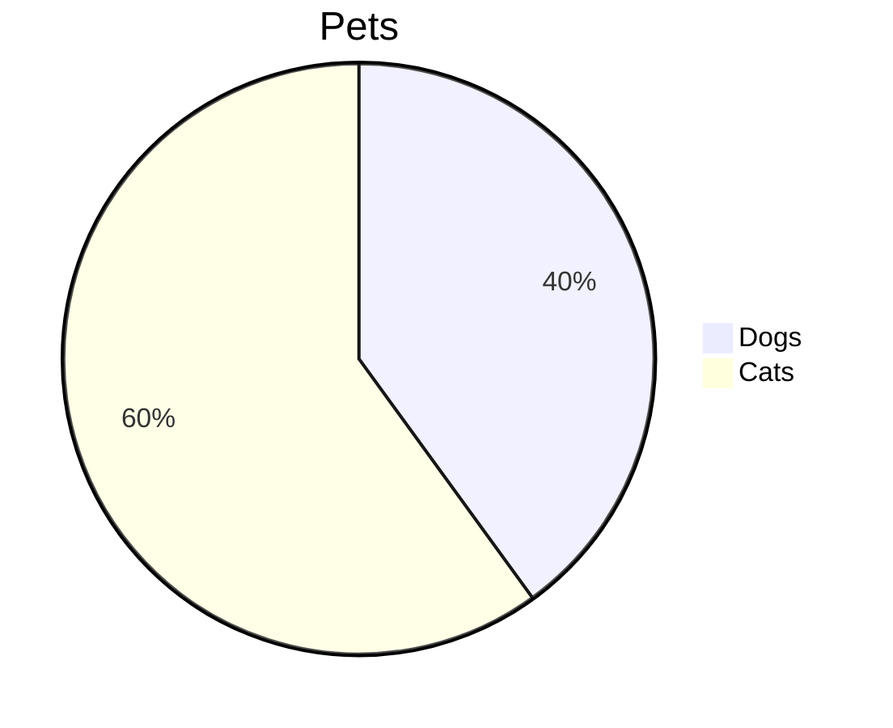

# Mermaid

## Flowchart: shapes and edges



## Flowchart: labels, chains, groups and styles



## Flowchart: other directions





## Sequence diagram



## Unsupported type



## Syntax error

```mermaid
flowchart TD
  A --> B
  B -->
```
