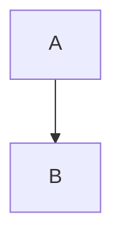

# Keyboard reach

Read the [guide](#details-section) first.

```rust
fn main() { println!("copy me"); }
```

- [ ] a task box

<details><summary>Show details</summary>

Details body text.

</details>

> [!NOTE]-
> A folded callout.

## Details section

A footnote reference.[^1]

| Name | Value |
|------|-------|
| a    | 1     |



[^1]: The note text.
