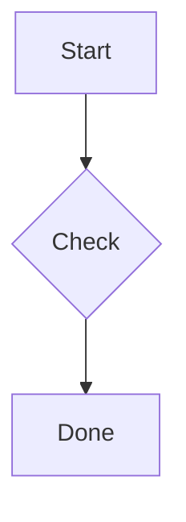

# Transient UI fixture (V2-C)

Read the [project site](https://example.com/docs "Project documentation") or the <abbr title="HyperText Markup Language">HTML</abbr> notes.[^1]

Water is H2O and the area is 10 m2.

## Pictures

## Diagram

## Table

| Name | Kind | Size |
|:-----|:-----|-----:|
| a.md | text | 12 |
| b.png | image | 340 |
| c.csv | data | 7 |

## Filler

Paragraph 1 of filler text so the document is taller than one screen of the test window.

Paragraph 2 of filler text so the document is taller than one screen of the test window.

Paragraph 3 of filler text so the document is taller than one screen of the test window.

Paragraph 4 of filler text so the document is taller than one screen of the test window.

[^1]: The footnote text that the tooltip previews: plain text, about three hundred characters at most, with *emphasis* removed.
