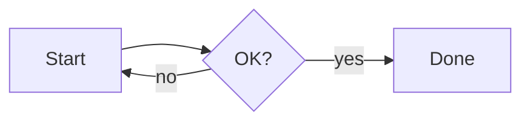
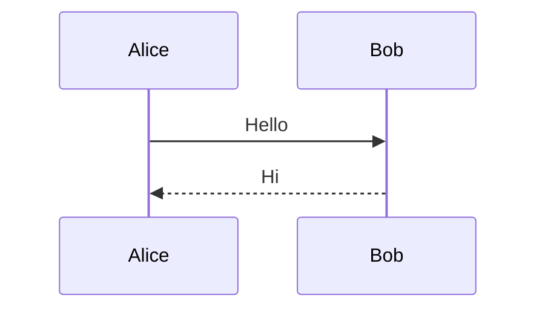

# Color check / Renk kontrolü

**How to test / Nasıl test edilir:**

1. **Before exporting:** select this sentence and search for "zebra" with Ctrl+F, so that a selection and find highlights are on screen.
   Dışa aktarmadan önce bu cümleyi seç ve Ctrl+F ile "zebra" ara.
2. **Export:** export to **PDF** and to **HTML**, in **light** mode and again in **dark** mode, so you get 4 files.
   PDF ve HTML'e, açık ve koyu modda aktar (4 dosya).
3. **Expected with the default setting (Light):** in all 4 files you see a white page, dark text and light block colors. There is no black or dark area anywhere, and no selection or find highlight.
   Varsayılan ayarla (Açık) 4 dosyada da beyaz sayfa, koyu yazı ve açık renkli bloklar olmalı. Hiçbir yerde siyah/koyu alan, seçim ya da arama vurgusu olmamalı.
4. **Expected with "Follow theme":** the dark-mode export is dark **everywhere**. A dark box on a white page is a bug.
   "Temayı takip et" ayarıyla koyu moddaki çıktı her yerde koyu olmalı. Beyaz sayfada koyu kutu hatadır.

## Headings / Başlıklar
### Heading 3
#### Heading 4
##### Heading 5
###### Heading 6

## Text / Metin
Plain text, **bold**, *italic*, ***bold italic***, ~~strikethrough~~, ==highlight==, `inline code`, an [external link](https://example.com) and a [relative link](./README.md).

## Code / Kod
```rust
// comment / yorum
fn main() {
    let name = "YAMDV"; // string
    let n: u32 = 42;    // number
    if n > 0 {
        println!("{name} {n}");
    }
}
```

## Quote / Alıntı
> A quote with a bar on the left.
> > A nested quote.

## Callouts
> [!NOTE]
> Note.

> [!TIP]
> Tip.

> [!IMPORTANT]
> Important.

> [!WARNING]
> Warning.

> [!CAUTION]
> Caution.

## Table / Tablo
| Token | Where / Nerede | Expected / Beklenen |
|---|---|---|
| table_header_bg | header row | light gray |
| zebra_bg | rows 2 and 4 | very light |
| border | cell lines | thin, visible |
| text | every cell | dark |

## Lists / Listeler
- [x] Done task
- [ ] Open task

1. First
2. Second

## Footnote / Dipnot
A sentence with a footnote.[^1]

[^1]: The footnote, with a back-link.

## Details
<details><summary>Click to open / Açmak için tıkla</summary>Hidden text / Gizli metin.</details>

---

## Math / Matematik
Inline: $e^{i\pi} + 1 = 0$. Block:

$$
\int_0^1 x^2\,dx = \frac{1}{3}
$$

## Mermaid



